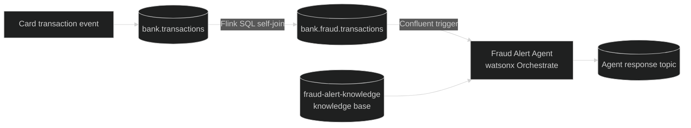

# Lab 1643: Real-Time Fraud Detection Agent with Confluent, watsonx Orchestrate and Bob

> This README was generated from the official Lab guide using IBM Bob. Please refer to the [IBM TechXchange 2026 Lab Guide 1643_v12.docx](./IB20TechXchange%202026%20Lab%20Guide%201643_v12.docx) for lab instructions

Hands-on lab (IBM TechXchange 2026) that builds an end-to-end, event-driven fraud detection workflow. Confluent Cloud (Kafka + Flink SQL) detects impossible-travel card transactions in real time, and a watsonx Orchestrate agent analyzes each alert against a fraud knowledge base and recommends an action. IBM Bob builds the agent and knowledge base from natural-language prompts.

## Architecture



1. A card swipe is published as an event to `bank.transactions`.
2. A Flink SQL filter compares it with earlier transactions on the same card. Impossible travel is flagged when two approved, card-present POS transactions on the same card occur within 2 hours, more than 300 km apart, at an implied speed above 800 km/h. Matches are written to `bank.fraud.transactions`.
3. Each new fraud event triggers the watsonx Orchestrate agent, which queries the `fraud-alert-knowledge` knowledge base, assigns a confidence (`low`, `medium`, `high`) and suggests an action (`monitor`, `review`, `create_case`, `escalate`).
4. The agent's report is written back to an output topic in Confluent.

## Repository layout

| Path | Contents |
|---|---|
| `bob-prompts/` | `knowledge-base-prompt.txt` and `agent-prompt.txt`, the prompts given to Bob |
| `knowledge-base/` | Reference documents indexed by the knowledge base: `fraud-playbook.pdf`, `decision-rules.pdf`, `agent-guardrails.pdf`, `customer-history-baselines.csv` |
| `agent/` | Agent spec generated by Bob |
| `confluent-setup/schemas/` | Avro schemas: `card-present-transaction.avsc` (input topic), `fraud-alert-input.avsc` (filtered topic) |
| `confluent-setup/sql/filter.sql` | Flink SQL impossible-travel filter |
| `confluent-setup/data/` | Five sample event pairs (`pair-01-nyc-london` to `pair-05-la-tokyo`) |
| `.bob/` | Bob config: `mcp.json` (watsonx Orchestrate MCP servers) and the `WXO Agent Architect` custom mode |
| `confluent_creds.example.env` | Template for Confluent credentials |

## Prerequisites

- IBM Bob installed
- An email address for a free [Confluent Cloud trial](https://www.confluent.io/confluent-cloud/tryfree/)
- Your IBMID, plus the watsonx Orchestrate `SERVICE_INSTANCE_URL` and `IAM_API_KEY` provided by the instructor
- [Confluent CLI](https://docs.confluent.io/confluent-cli/current/install.html), [git](https://git-scm.com/) and [uv](https://docs.astral.sh/uv/)

## Setup

1. **Clone and open** the repo, then open `financial-fraud-detection` in Bob.

   ```bash
   git clone https://github.com/eladixit/Lab-1643.git
   ```

2. **Confluent account.** Sign up for the trial and create a cluster. The promo code `CONFLUENTDEV1` applies on the payment screen.
3. **Save Confluent credentials.** Run `confluent login`. Then, in Bob's Agent mode, ask it to use the `confluent` CLI to retrieve the required values, create API keys, and write them into `confluent_creds.env`. Copy `confluent_creds.example.env` to that file first and verify every variable is filled in.
4. **Install the ADK CLI.**

   ```bash
   uv sync --locked
   source .venv/bin/activate
   orchestrate --help
   ```

5. **Configure the MCP server.** In `.bob/mcp.json`, set `WXO_MCP_WORKING_DIRECTORY` for `watsonx-orchestrate-adk` to your local `financial-fraud-detection` path. Refresh MCP servers in Bob settings until both show Connected.
6. **Connect to your tenant.**

   ```bash
   uv run orchestrate env add --name confluent_bootcamp --url <SERVICE_INSTANCE_URL>
   uv run orchestrate env activate confluent_bootcamp --api-key <IAM_API_KEY>
   ```

## Build the agent with Bob

1. Select the **WXO Agent Architect** mode in Bob.
2. Knowledge base: send `@bob-prompts/knowledge-base-prompt.txt`. Bob creates and imports `fraud-alert-knowledge`.
3. Agent: send `Please create and import an agent @bob-prompts/agent-prompt.txt`.
4. In the watsonx Orchestrate UI, open **Active inventory > Agents**, select the agent, and test it by pasting both events from `pair-01-nyc-london` as one message. Use **Show Reasoning** to see the knowledge base calls.
5. Deploy: **Deploy > Deploy to Live**, create a version (e.g. `TXC-V1`, `1.0.0`), then deploy it.

## Configure the Confluent pipeline

In the agent's **Build** tab, under **Triggers**, click **Create Pipeline** under Confluent, then:

1. Name the connection (e.g. `Confluent TXC`) and enter the Confluent, Kafka, Flink and (optional) Schema Registry credentials from `confluent_creds.env`.
2. Select the default environment and your cluster.
3. Create the input topic `bank.transactions.<firstnamelastname>` using `confluent-setup/schemas/card-present-transaction.avsc`.
4. Create the filtered topic `bank.fraud.transactions.<firstnamelastname>` using `confluent-setup/schemas/fraud-alert-input.avsc`.
5. Edit the filtered topic, choose **Raw SQL**, and paste `confluent-setup/sql/filter.sql`. Replace `<FIRSTNAMELASTNAME>` in the output topic (line 1) and both input topic references (lines 23 and 32).
6. Name the pipeline (e.g. `Bank Fraud Pipeline`), set the **Key Field** to `transactionId`, and create it.

## Test the scenarios

1. In the pipeline view, click **Push Events via API**. It shows a `curl` command and a token. Rotate the token to get a new one.
2. Give Bob the `curl` command, the token, and the instruction to send the events from `confluent-setup/data/pair-01-nyc-london` to the pipeline. Each file is wrapped as `{"event": {...}}` and sent as an HTTP `POST`. A `202 accepted` response means the pipeline received the event.
3. Wait a minute and refresh. The pipeline graph updates as events are processed.
4. In Confluent Cloud, check the topics: the input topic holds both events, the filtered topic holds the joined fraud event, and the auto-generated output topic holds the agent's response.
5. In Orchestrate, open **Observability**, select the agent, and open the **Conversations** tab to read the agent's analysis.

The remaining pairs can be sent the same way:

| Pair | Route | `cardHash` |
|---|---|---|
| `pair-01-nyc-london` | New York → London | `CARD_MANUAL_TEST_v3` |
| `pair-02-dubai-sydney` | Dubai → Sydney | `CARD_MANUAL_TEST_v4` |
| `pair-03-paris-sao-paulo` | Paris → São Paulo | `CARD_MANUAL_TEST_v5` |
| `pair-04-singapore-chicago` | Singapore → Chicago | `CARD_MANUAL_TEST_v6` |
| `pair-05-la-tokyo` | Los Angeles → Tokyo | `CARD_MANUAL_TEST_v7` |

Each pair uses its own `cardHash` because the filter joins any two qualifying events on the same card. Sharing a card across pairs produces extra cross-pair alerts.

## References

- [Confluent Cloud documentation](https://docs.confluent.io/cloud/current/overview.html)
- [Flink SQL reference](https://docs.confluent.io/cloud/current/flink/reference/overview.html)
- [Schema Registry guide](https://docs.confluent.io/platform/current/schema-registry/index.html)
- [watsonx Orchestrate documentation](https://www.ibm.com/docs/en/watsonx/watson-orchestrate)
- [watsonx Orchestrate ADK](https://developer.watson-orchestrate.ibm.com/)

## License

See [`LICENSE`](LICENSE).
