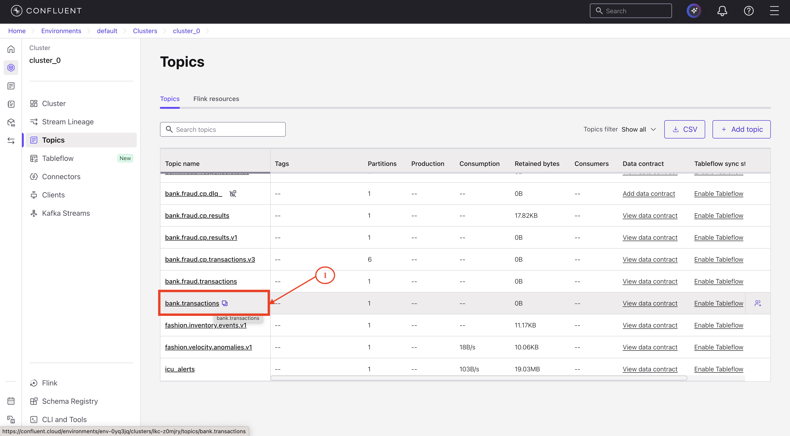
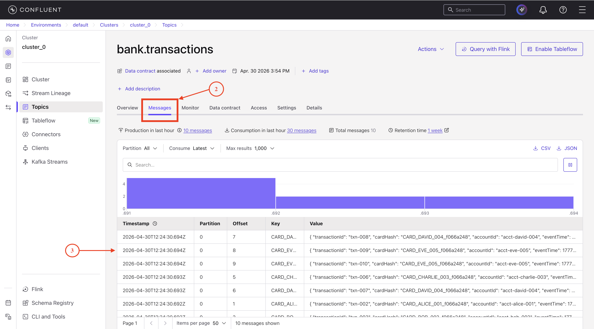
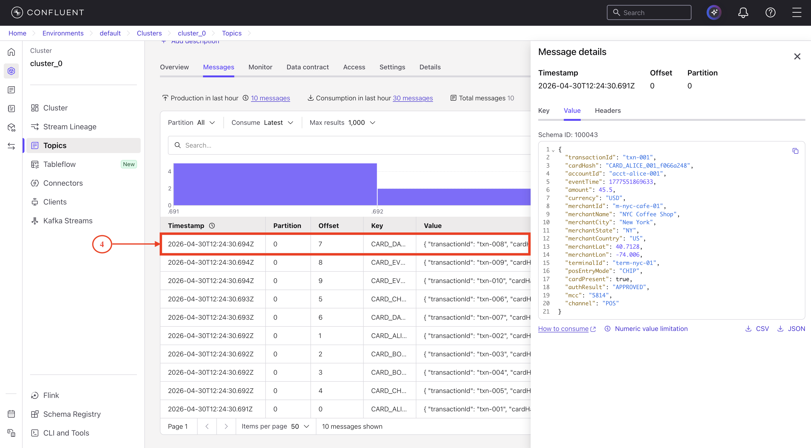
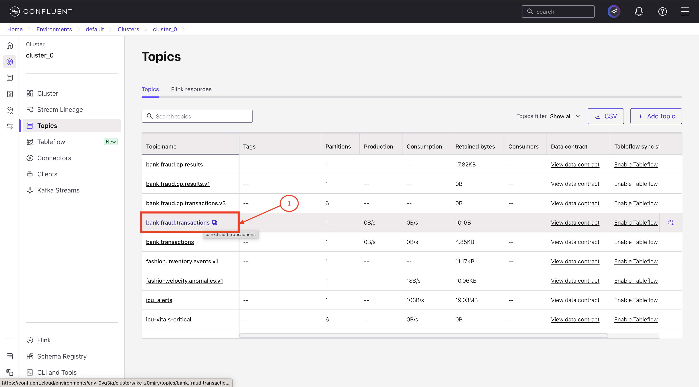
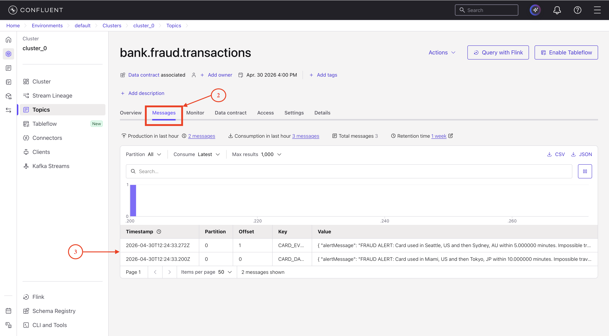
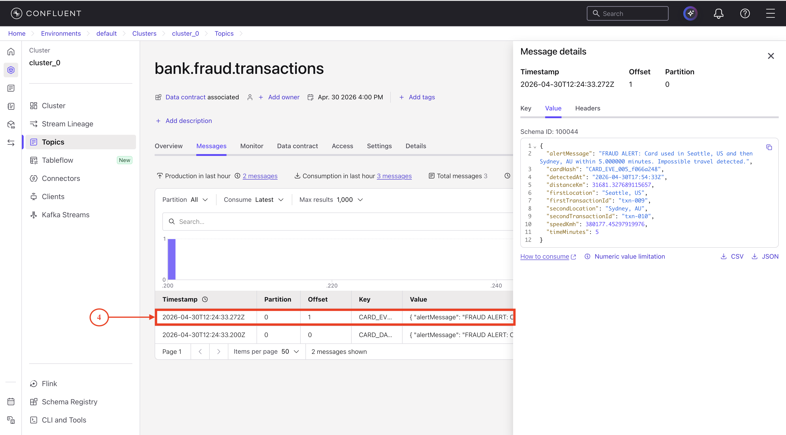

# Lab 2: Testing Fraud Detection Scenarios

## Overview

In Lab 2, you will test the fraud detection pipeline built in Lab 1 by sending realistic transaction data and verifying that the system correctly identifies impossible travel patterns.

This lab provides a complete walkthrough that results in:

- A configured Python environment connected to Confluent Cloud
- Test transactions sent to the input topic with proper formatting
- Fraud alerts consumed and displayed from the output topic
- Verification that the fraud detection logic works correctly

---

## Learning Objectives

By completing this lab, you will learn how to:

- Configure Python applications to connect to Confluent Cloud using API keys
- Send test transactions with proper timestamp formatting to Kafka topics
- Consume and interpret fraud alerts from the results topic
- Analyze fraud detection accuracy and system behavior

---

## Prerequisites

Before starting Lab 2, ensure you have completed:

- **[Lab 1](../lab1-confluent-setup/README.MD)** - Confluent Cloud setup with running Flink query
- **Prerequisites from main README** - See [Prerequisites](../../../README.md#prerequisites) section for:
  - uv package manager installation
  - Git installation

> [!TIP]
> If you haven't installed uv yet, follow the [Installing uv](../../../README.md#installing-uv) instructions in the main README.

---

## Architecture Overview

This lab tests the fraud detection pipeline built in Lab 1:

```
┌─────────────────────────────────────────────────────────────────┐
│                    Your Test Workflow                           │
│                                                                 │
│  1. Python Producer                                             │
│     └─> Sends test transactions                                 │
│         └─> bank.transactions                                   │
│                                                                 │
│  2. Flink SQL (already running)                                 │
│     └─> Detects fraud patterns                                  │
│         └─> bank.fraud.transactions                             │
│                                                                 │
│  3. Python Consumer                                             │
│     └─> Reads fraud alerts                                      │
│         └─> Displays results                                    │
└─────────────────────────────────────────────────────────────────┘
```

---

## Step 1: Environment Setup

> [!NOTE]
> If you've already completed the [Getting Started](../../../README.md#getting-started) section in the main README, you can skip to [Step 1.2](#12-configure-environment-variables).

### 1.1 Clone Repository and Install Dependencies

Follow the [Getting Started](../../../README.md#getting-started) instructions in the main README:

1. Clone the repository
2. Install dependencies with `uv sync --locked`

This will create a virtual environment and install all required dependencies.

---

### 1.2 Configure Environment Variables

1. Navigate to the `consumer-app` directory:
```bash
cd financial-fraud-detection/consumer-app
```

2. Copy the example file:
```bash
cp .env.example .env
```

3. Edit `.env` with your credentials from Lab 1:

```bash
# Kafka Configuration
KAFKA_BOOTSTRAP_SERVERS=pkc-xxxxx.us-central1.gcp.confluent.cloud:9092
KAFKA_API_KEY=your_kafka_api_key_from_lab1
KAFKA_API_SECRET=your_kafka_api_secret_from_lab1
KAFKA_TOPIC=bank.transactions
KAFKA_GROUP_ID=fraud-test-consumer-group
KAFKA_AUTO_OFFSET_RESET=earliest

# Schema Registry Configuration
SCHEMA_REGISTRY_URL=https://psrc-xxxxx.us-central1.gcp.confluent.cloud
SCHEMA_REGISTRY_API_KEY=your_schema_registry_key_from_lab1
SCHEMA_REGISTRY_API_SECRET=your_schema_registry_secret_from_lab1

# Result Configuration
RESULT_MODE=stdout
RESULT_TOPIC=bank.fraud.transactions
```

**Where to find each value:**
- `KAFKA_BOOTSTRAP_SERVERS`: [Lab 1 → Section 1.4 → Get Kafka Bootstrap Server](../lab1-confluent-setup/README.MD#14-get-connection-endpoints)
- `KAFKA_API_KEY` & `KAFKA_API_SECRET`: [Lab 1 → Section 1.3 → Kafka API Key](../lab1-confluent-setup/README.MD#13-create-api-keys)
- `SCHEMA_REGISTRY_URL`: [Lab 1 → Section 1.4 → Get Schema Registry URL](../lab1-confluent-setup/README.MD#14-get-connection-endpoints)
- `SCHEMA_REGISTRY_API_KEY` & `SCHEMA_REGISTRY_API_SECRET`: [Lab 1 → Section 1.3 → Schema Registry API Key](../lab1-confluent-setup/README.MD#13-create-api-keys)

---

## Step 2: Send Test Transactions

### 2.1 Understand Test Data

View the test data:
```bash
cat ../confluent-setup/data/test_mixed_transactions.csv
```

**Test scenarios included:**

| Card | Scenario | From | To | Time | Distance | Speed | Expected |
|------|----------|------|----|----|----------|-------|----------|
| ALICE | Legitimate | New York | New York | 2 hours | 0 km | 0 km/h | No alert |
| BOB | Legitimate | Boston | Boston | 1 hour | 0 km | 0 km/h | No alert |
| CHARLIE | Legitimate | Chicago | Chicago | 3 hours | 0 km | 0 km/h | No alert |
| DAVID | **FRAUD** | Miami | Tokyo | 10 min | 24,427 km | 146,563 km/h | **Alert!** |
| EMMA | **FRAUD** | Seattle | Sydney | 5 min | 12,051 km | 144,612 km/h | **Alert!** |

---

### 2.2 Start the Consumer

Run the consumer that will display alerts as they are received:

```bash
uv run consume_fraud_alerts.py
```

---

### 2.3 Send Test Transactions

Open a new terminal and run the producer:

```bash
cd financial-fraud-detection/consumer-app
uv run produce_test_with_current_time.py --csv-file ../confluent-setup/data/test_mixed_transactions.csv
```

This script:
1. Reads the CSV file
2. Adjusts timestamps to current time (important for watermarks)
3. Serializes with Schema Registry
4. Sends to `bank.transactions` topic

**Expected output:**
```
[1/10] Card: CARD_ALICE_001 | Location: New York, US | Amount: $45.50
✅ Sent successfully

...

[10/10] Card: CARD_DAVID_004 | Location: Tokyo, JP | Amount: $120.00
✅ Sent successfully

========================================
✅ ALL MESSAGES SENT SUCCESSFULLY
========================================
Total messages: 10
Topic: bank.transactions
```

---

### 2.4 Verify in Confluent Cloud UI

Confirm messages arrived in Kafka:

1. Go to Confluent Cloud → **Topics** → `bank.transactions`

   

2. Click **"Messages"** tab


3. You should see 10 messages

   

4. Click on a message to view details:
   - Key: `CARD_ALICE_001` (or similar)
   - Value: JSON with transaction details
   - Timestamp: Recent (within last few minutes)

      

---

## Step 3: Verify Fraud Detection

### 3.1 Wait for Processing

⏱️ **Wait 2-3 minutes** for Flink to process transactions and generate alerts.

Monitor in Confluent Cloud:
1. Go to **Flink** → **Running statements**
2. Click on your fraud detection query
3. Check metrics:
   - Records in: Should show 10
   - Records out: Should show 2 (fraud alerts)

---

### 3.2 Review Consumer Output

Navigate back to your terminal where `consume_fraud_alerts.py` is running.

**Expected output:**
```
======== FRAUD ALERT CONSUMER STARTED ========
Topic      : bank.fraud.transactions
Group ID   : fraud-alert-consumer-group
==============================================

🚨 FRAUD DETECTED | Card: CARD_DAVID_004 | Miami, US → Tokyo, JP | Distance: 24427 km in 10 min (146563 km/h)

🚨 FRAUD DETECTED | Card: CARD_EMMA_005 | Seattle, US → Sydney, AU | Distance: 12051 km in 5 min (144612 km/h)

Waiting for more messages... (Press Ctrl+C to exit)
```

**Success criteria:**
- ✅ 2 fraud alerts (DAVID and EMMA)
- ✅ Correct card IDs and locations
- ✅ Accurate distance calculations
- ✅ Impossible speeds (>100,000 km/h)
- ✅ No alerts for ALICE, BOB, or CHARLIE (legitimate transactions)

Press `Ctrl+C` to stop the consumer.

---

### 3.3 Verify in Confluent Cloud

1. Go to **Topics** → `bank.fraud.transactions`

     

2. Click **"Messages"** tab
3. You should see 2 fraud alert messages

     

4. Click on a message to view the fraud alert details

     

---

## Expected Outcome

Upon successful completion of this lab, you will have:

**Environment Setup**
- Python environment configured with uv package manager
- Dependencies installed and ready to use
- Environment variables properly configured

**Test Data Sent**
- 10 transactions across 5 cards
- Mix of legitimate and fraudulent patterns
- Proper timestamp formatting

**Fraud Detection Verified**
- 2 fraud alerts generated (DAVID and EMMA)
- 0 false positives on legitimate transactions
- Accurate distance and speed calculations

**System Validated**
- Flink metrics showing healthy processing
- Schema validation working correctly
- End-to-end latency < 1 second

---

## Understanding the Results

### Why DAVID and EMMA Triggered Alerts

**CARD_DAVID_004:**
- Miami, US → Tokyo, JP
- Distance: 24,427 km in 10 minutes
- Speed: 146,563 km/h (73x faster than supersonic jets!)

**CARD_EMMA_005:**
- Seattle, US → Sydney, AU
- Distance: 12,051 km in 5 minutes
- Speed: 144,612 km/h (72x faster than supersonic jets!)

### Why Others Didn't Trigger Alerts

**CARD_ALICE_001, CARD_BOB_002, CARD_CHARLIE_003:**
- Same location for both transactions
- Distance: 0 km, Speed: 0 km/h
- Below 300 km threshold, no alert

---

## Troubleshooting

### No Fraud Alerts Received

**Possible causes:**
1. Flink query not running
2. Timestamps too old (outside watermark window)
3. Test data doesn't meet thresholds

**Solutions:**
- Check Flink query status in Confluent Cloud
- Resend with current timestamps: `uv run produce_test_with_current_time.py`
- Verify thresholds in SQL query (distance > 300 AND speed > 800)

### Connection Errors

**Error:** `Failed to connect to broker`

**Solutions:**
1. Check `.env` has correct `KAFKA_BOOTSTRAP_SERVERS`
2. Verify API keys are valid (not expired)
3. Check network connectivity to Confluent Cloud

### Schema Validation Errors

**Solutions:**
1. Verify using correct schema (`bank.transactions.value`)
2. Check `eventTime` format is correct
3. Ensure all required fields are present

---

## Next Steps

**Ready for Part 2?** → [watsonx Orchestrate Agent Integration](../../part2-watsonx-orchestrate/README.md)
