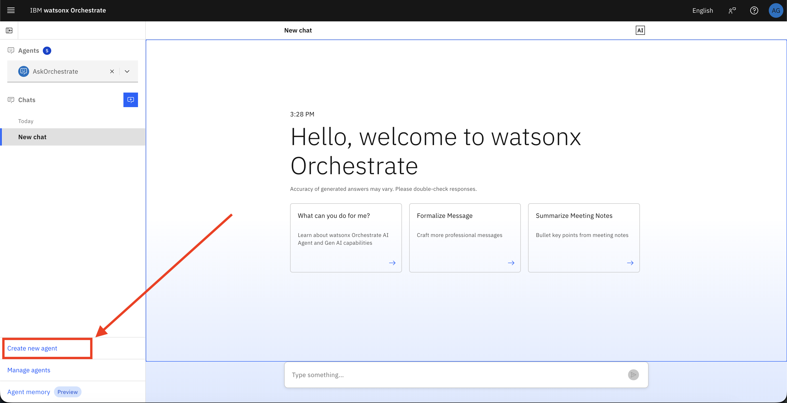
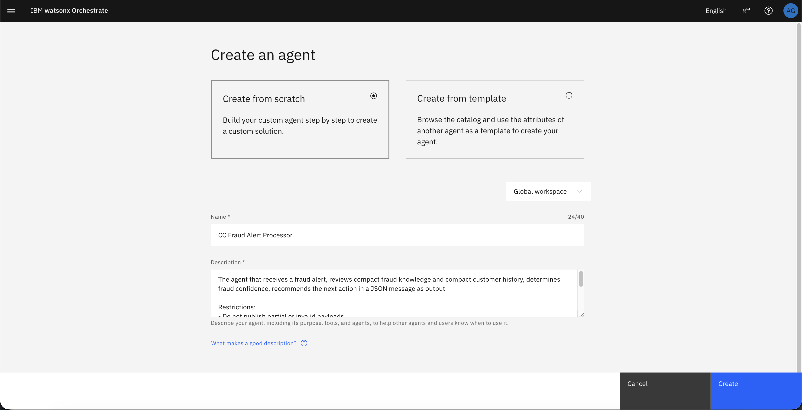
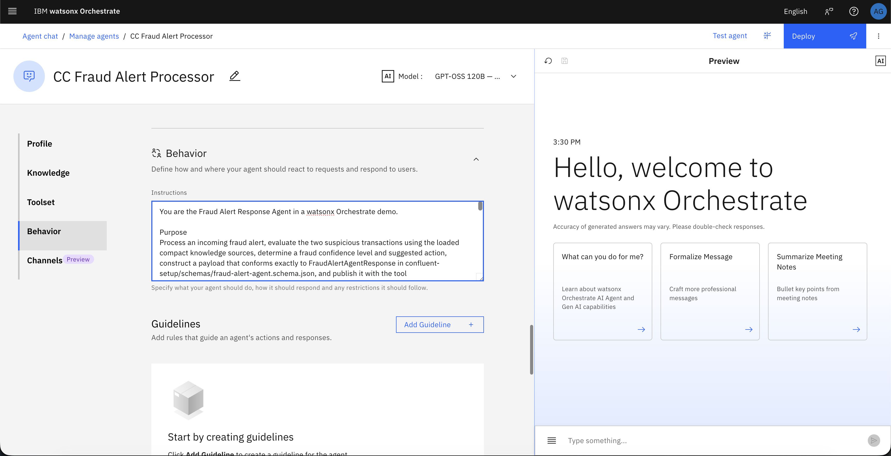
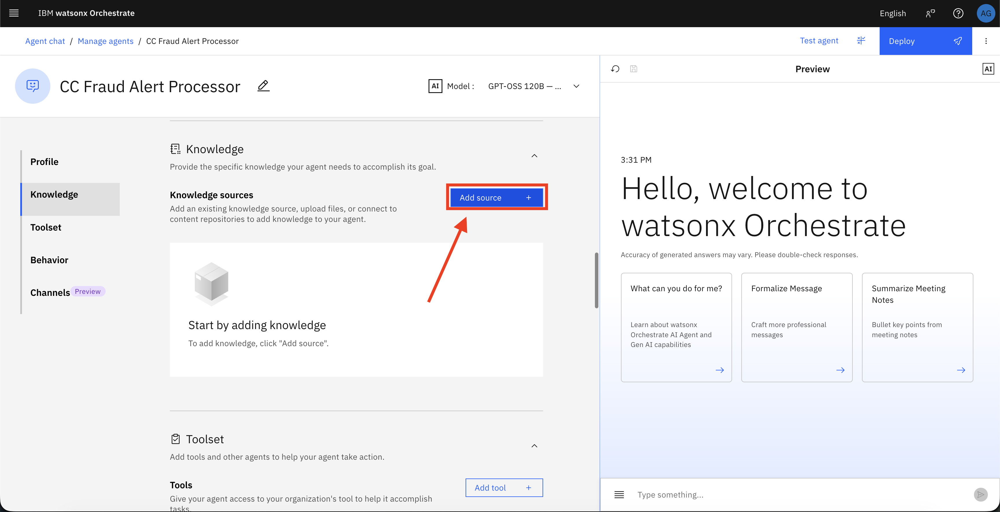
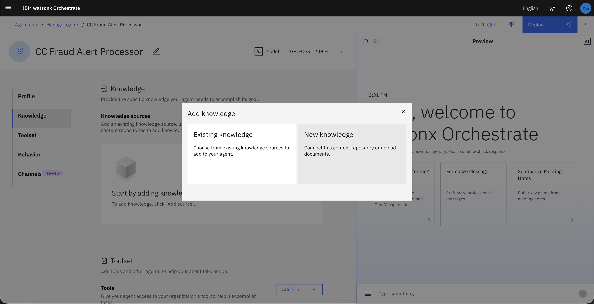
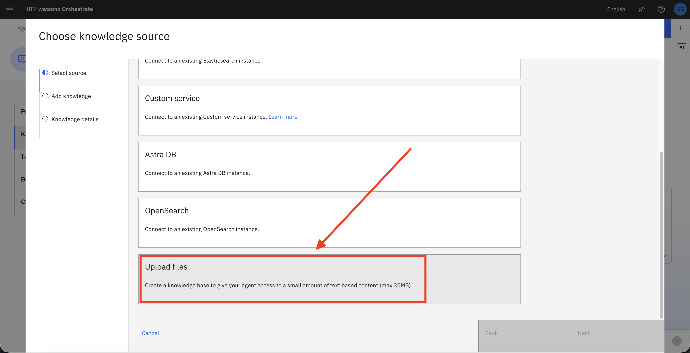
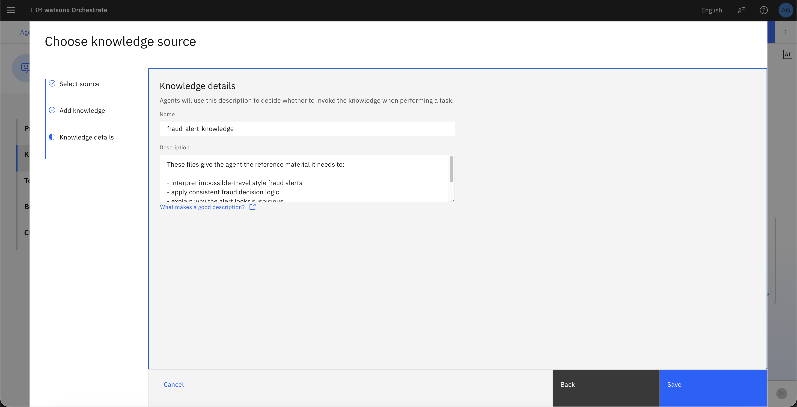
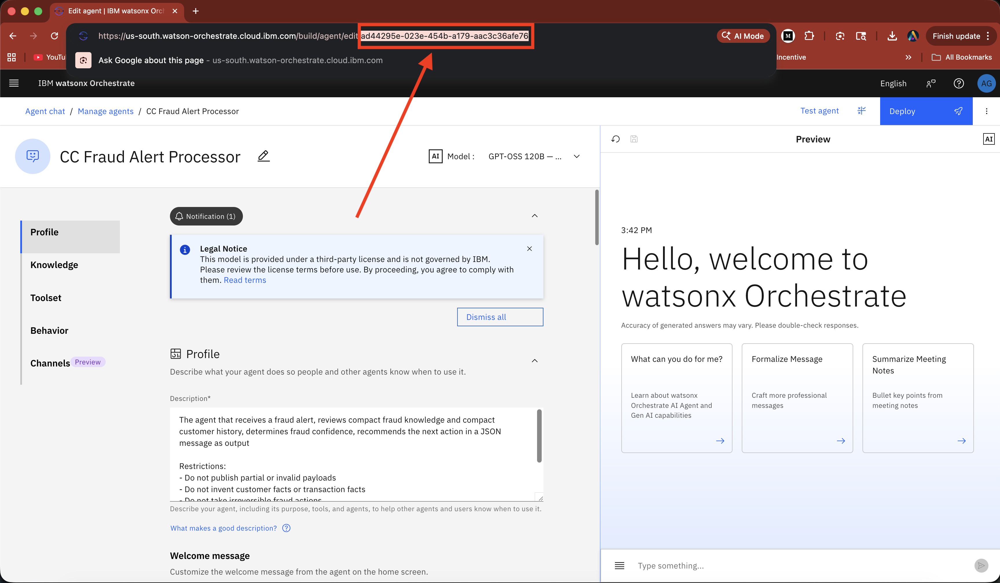
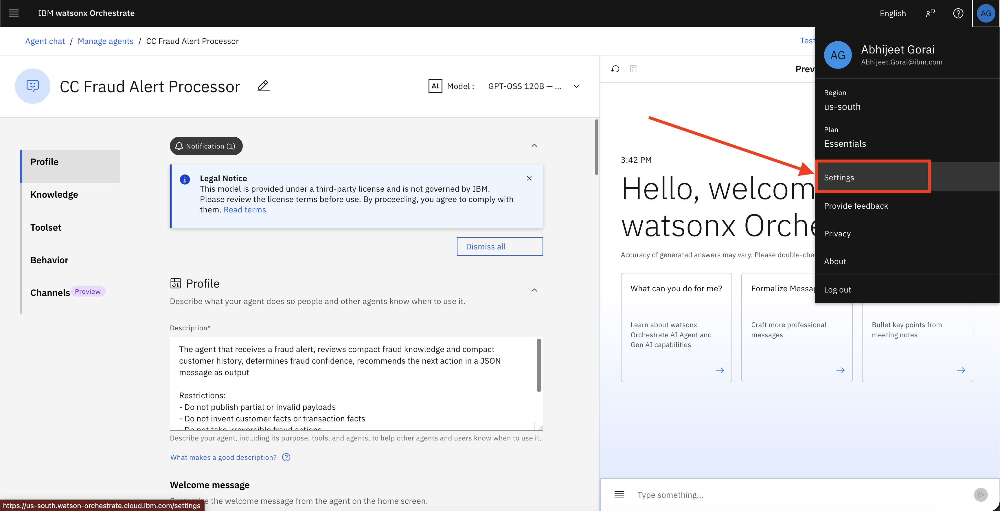

# Part 2: watsonx Orchestrate Agent Integration

## Overview

In Part 2, you will integrate the fraud detection pipeline from Part 1 with a watsonx Orchestrate agent. This agent reviews fraud alerts, analyzes risk factors, and returns a structured response that the Python consumer validates and publishes to Kafka.

This lab provides a complete walkthrough that results in:

- A configured watsonx Orchestrate agent named **CC Fraud Alert Processor**
- A fraud knowledge base attached to the agent for intelligent decision-making
- Integration credentials required by the Python consumer application
- An end-to-end workflow from Kafka fraud alerts to agent-enriched responses

---

## Setup Options

You can set up the watsonx Orchestrate agent using either of these approaches:

### Option 1: Manual Setup via UI (This Guide)
Follow the steps below to create and configure the agent manually through the watsonx Orchestrate user interface. This approach provides hands-on experience with the platform.

### Option 2: Automated Setup via IBM BOB
For a faster, automated setup using IBM BOB (watsonx Orchestrate Agent Architect mode), see the [BOB Setup Guide](./setup-with-bob.md). After completing the BOB setup, return to [Step 4](#step-4-configure-the-python-consumer) in this guide to continue with the Python consumer configuration.

---

## Learning Objectives

By completing this lab, you will learn how to:

- Create and configure a watsonx Orchestrate agent through the UI
- Upload and attach fraud investigation knowledge sources to the agent
- Extract runtime credentials for application integration
- Configure the Python consumer to invoke the agent via API
- Validate the complete fraud-alert-to-agent-response workflow

---

## Prerequisites

Before starting Part 2, ensure you have completed:

- **[Part 1](../part1-confluent-cep/lab1-confluent-setup/README.MD)** - Confluent fraud detection pipeline
- A working fraud detection pipeline with alerts flowing to the Kafka results topic
- **watsonx Orchestrate instance** - [Reserve via TechZone](../../README.md#reserving-watsonx-orchestrate-on-techzone)

> [!IMPORTANT]
> If you haven't reserved a watsonx Orchestrate instance yet, follow the [Reserving watsonx Orchestrate on TechZone](../../README.md#reserving-watsonx-orchestrate-on-techzone) instructions in the main README. This typically takes 15-30 minutes to provision.

You should also have the Python consumer application available in [`consumer-app`](../../consumer-app).

---

## Architecture Overview

This lab extends the Part 1 fraud detection flow with an AI-powered fraud review step:

```
1. Kafka produces fraud alert
   ↓
2. Python consumer reads alert
   ↓
3. Consumer sends alert to watsonx Orchestrate agent
   ↓
4. Agent analyzes alert and returns structured fraud decision
   ↓
5. Consumer validates response and publishes to agent response topic
```

---

## Step 1: Create the Watsonx Orchestrate Agent

### 1.1 Create New Agent

1. Log in to your watsonx Orchestrate environment
2. Click **Create New Agent** in the bottom left corner

   

### 1.2 Configure Agent Details

Fill in the agent name and description with the following **exact values**, then click **Create**.



**Agent Name:**
```
CC Fraud Alert Processor
```

**Agent Description:**
```text
The agent that receives a fraud alert, reviews compact fraud knowledge and compact customer history, determines fraud confidence, recommends the next action in a JSON message as output

Restrictions:
- Do not publish partial or invalid payloads
- Do not invent customer facts or transaction facts
- Do not take irreversible fraud actions
- Keep the logic compact and demo-friendly
- Make the reasoning explainable and concise
- Publish only after the agent has formed a complete decision
```

### 1.3 Configure Agent Instructions

Scroll down to the **Behavior** section and paste the following instructions:



```text
You are the Fraud Alert Response Agent in a watsonx Orchestrate demo.

Purpose
Process an incoming fraud alert, evaluate the two suspicious transactions using the loaded compact knowledge sources, determine a fraud confidence level and suggested action, construct a payload that conforms exactly to FraudAlertAgentResponse in confluent-setup/schemas/fraud-alert-agent.schema.json, and publish it with the tool publish_fraud_agent_response.

Knowledge sources (load as read-only knowledge)
- fraud-playbook.pdf
- decision-rules.pdf
- agent-guardrails.pdf
- customer-history-baselines.csv
- customer-history-summary.json
- customer-history-examples.json

Workflow

1. Receive alert
Input contains at least:
- cardHash
- alertMessage
- firstTransaction
- secondTransaction

2. Extract and organize
Capture the transaction facts exactly as provided or derived:
- transactionId
- eventTime
- amount
- currency if available
- merchantName
- merchantCity
- merchantState if available
- merchantCountry
- mcc if available

Do not invent values. If an optional value is unavailable, omit it rather than fabricating it.

3. Build travelAnalysis
Construct a travelAnalysis object with:
- firstLocation
- secondLocation
- distanceKm
- timeMinutes
- speedKmh

These fields must be present in the final payload.

4. Consult knowledge
Use the loaded knowledge to:
- compare the transactions with recent customer history
- identify impossible-travel signals
- determine whether location, amount, and merchant patterns are normal or unusual
- apply demo guardrails

5. Determine confidence
Set agentDecision.confidenceLevel to exactly one of:
- low
- medium
- high

If included, agentDecision.confidenceScore must be an integer from 0 to 100.
Do not use decimals such as 0.2 or 0.98.

6. Select suggested action
Set agentDecision.suggestedAction to exactly one of:
- monitor
- review
- create_case
- escalate

Recommended mapping:
- high -> escalate
- medium -> review or create_case
- low -> monitor

7. Build the final payload
The final payload must follow this structure exactly:

{
  "cardHash": "string",
  "accountId": "string, optional",
  "alertMessage": "string",
  "detectedAt": "ISO-8601 date-time string, optional",
  "firstTransaction": {
    "transactionId": "string",
    "eventTime": "ISO-8601 date-time string",
    "amount": 0,
    "currency": "string, optional",
    "merchantName": "string",
    "merchantCity": "string",
    "merchantState": "string, optional",
    "merchantCountry": "string",
    "mcc": "string, optional"
  },
  "secondTransaction": {
    "transactionId": "string",
    "eventTime": "ISO-8601 date-time string",
    "amount": 0,
    "currency": "string, optional",
    "merchantName": "string",
    "merchantCity": "string",
    "merchantState": "string, optional",
    "merchantCountry": "string",
    "mcc": "string, optional"
  },
  "travelAnalysis": {
    "firstLocation": "string",
    "secondLocation": "string",
    "distanceKm": 0,
    "timeMinutes": 0,
    "speedKmh": 0
  },
  "customerHistorySummary": {
    "baselineRegion": "string, optional",
    "usualCountries": ["string"],
    "typicalMinAmount": 0,
    "typicalMaxAmount": 0,
    "typicalMerchants": ["string"],
    "historyNote": "string"
  },
  "agentDecision": {
    "confidenceLevel": "low | medium | high",
    "confidenceScore": 0,
    "reasoning": [
      "short reason 1",
      "short reason 2"
    ],
    "suggestedAction": "monitor | review | create_case | escalate",
    "actionRationale": "string, optional",
    "analystSummary": "string, optional"
  }
}

Schema rules that must always be respected
- Required top-level fields:
  - cardHash
  - alertMessage
  - firstTransaction
  - secondTransaction
  - travelAnalysis
  - agentDecision
- customerHistorySummary, if included, must be an object, not a string
- agentDecision.reasoning must be an array of one or more strings, not a single string
- agentDecision.confidenceScore, if included, must be an integer from 0 to 100
- agentDecision.confidenceLevel must be exactly one of: low, medium, high
- agentDecision.suggestedAction must be exactly one of: monitor, review, create_case, escalate
- Do not include fields outside the schema
- Do not publish partial payloads

8. Validate before publishing
Before calling the publish tool, check:
- all required top-level fields are present
- customerHistorySummary is an object if present
- reasoning is an array of strings
- confidenceScore is an integer if present
- confidenceLevel and suggestedAction use only allowed enum values

If any rule fails, correct the payload before publishing.

9. Publish
Call publish_fraud_agent_response once, using the fully assembled and schema-compliant payload.
Do not call the tool with partial or invalid data.

10. Final output
Return the publish confirmation from the tool as the final agent output.

Restrictions
- Do not read knowledge files as tools; use them only as loaded knowledge
- Do not fabricate customer or transaction facts
- Do not use placeholder strings where structured objects are required
- Do not use decimal confidenceScore values
- Do not use a single string for reasoning; always use an array of strings
- Keep reasoning concise, operational, and demo-friendly
- Publish only after the payload is complete and schema-compliant

Output discipline
When producing the final payload, think in this order:
1. Fill required transaction facts
2. Fill travelAnalysis
3. Fill customerHistorySummary as an object if used
4. Fill agentDecision using schema-valid types
5. Validate enums and required fields
6. Publish
```

> [!IMPORTANT]
> Do not paraphrase or shorten the description or instructions. The consumer expects the agent to return a schema-aligned response, so the instructions must remain consistent with the lab design.

---

## Step 2: Upload Knowledge Files

The agent requires fraud investigation knowledge to make informed decisions.

### 2.1 Add Knowledge Source

1. Scroll to the **Knowledge** section and click **Add source**

   

2. Click **New Knowledge**

   

3. Click **Upload Files**

   

### 2.2 Upload Required Files

4. Upload the following files from the `fraud-alert-demo-knowledge` directory:
   - `agent-guardrails.pdf`
   - `fraud-playbook.pdf`
   - `decision-rules.pdf`
   - `customer-history-baselines.csv`

   

5. Click **Next**

### 2.3 Configure Knowledge Base

6. Enter the knowledge base details:

   **Name:**
   ```
   fraud-alert-knowledge
   ```

   **Description:**
   ```
   These files give the agent the reference material it needs to:

   - interpret impossible-travel style fraud alerts
   - apply consistent fraud decision logic
   - explain why the alert looks suspicious
   - stay within the response boundaries defined for the demo
   ```

   

7. Click **Save**

---

## Step 3: Capture Integration Credentials

You need to extract several values from watsonx Orchestrate to configure the Python consumer.

### 3.1 Extract Agent ID

1. With the agent open, examine your browser's address bar
2. The URL will look similar to:
   ```
   https://us-south.watson-orchestrate.cloud.ibm.com/build/agent/edit/<AGENT_ID>
   ```
3. Copy the UUID at the end of the URL - this is your **`WXO_AGENT_ID_OR_NAME`** value

   

### 3.2 Extract Instance URL

1. Click the **profile icon** in the top right corner
2. Select **Settings**

   

3. Navigate to the **API details** tab
4. Copy the **Service Instance URL** - this is your **`WXO_INSTANCE_URL`** value

   

### 3.3 Generate API Key

The API key generation process differs based on your watsonx Orchestrate deployment:

#### For AWS Cloud Deployment

1. Click **Generate API key** button
2. The API key will be generated directly in the interface
3. Copy the generated key - this is your **`WXO_API_KEY`** value

#### For IBM Cloud Deployment

1. Click **Generate API key** button
2. You will be redirected to the **API Keys** page in IBM Cloud
3. Click the **Create** button
4. Enter a name for your API key (e.g., "wxo-api-key")
5. Click **Create** to generate the key
6. Copy the generated key - this is your **`WXO_API_KEY`** value

> [!IMPORTANT]
> - Keep these values secure and available for the next step. The Python consumer requires them to authenticate and invoke the agent.
> - Make sure to set `WXO_INSTANCE_CLOUD` to either `aws` or `ibmcloud` based on your deployment type.

**Required Environment Variables:**
- `WXO_INSTANCE_URL` - Service instance URL
- `WXO_AGENT_ID_OR_NAME` - Agent UUID
- `WXO_API_KEY` - Generated API key
- `WXO_INSTANCE_CLOUD` - Either `aws` or `ibmcloud`

---

## Step 4: Configure the Python Consumer

Update your environment configuration to enable agent integration.

### 4.1 Configure Environment Variables

1. Navigate to the `consumer-app` directory
2. Copy `.env.example` to `.env` if you haven't already
3. Add the watsonx Orchestrate credentials you captured in Step 3:

```bash
# Watsonx Orchestrate Configuration
WXO_INSTANCE_URL=<your-instance-url>
WXO_AGENT_ID_OR_NAME=<your-agent-id>
WXO_INSTANCE_CLOUD=ibmcloud  # or aws
WXO_API_KEY=<your-api-key>
```

### 4.2 How It Works

The consumer application uses these credentials through [`orchestrate_client.py`](../../consumer-app/orchestrate_client.py), which:

1. **Authenticates** - Exchanges the API key for a bearer token
2. **Invokes** - Calls the watsonx Orchestrate chat completions endpoint
3. **Parses** - Extracts the structured response from the agent
4. **Returns** - Provides a validated payload to the consumer

The workflow is handled by:
- **[`agent_payload_builder.py`](../../consumer-app/agent_payload_builder.py)** - Transforms Kafka alerts into agent requests
- **[`orchestrate_client.py`](../../consumer-app/orchestrate_client.py)** - Manages API communication
- **[`response_validator.py`](../../consumer-app/response_validator.py)** - Validates responses against the schema
- **[`agent_response_producer.py`](../../consumer-app/agent_response_producer.py)** - Publishes validated responses to Kafka

---

## Step 5: Run the End-to-End Workflow

Test the complete integration from fraud detection to agent-enriched response.

### 5.1 Start the Test Data Producer

Generate test transactions that trigger fraud alerts:

```bash
cd financial-fraud-detection/consumer-app
uv run produce_test_with_current_time.py --csv-file ../confluent-setup/data/test_mixed_transactions.csv
```

This script publishes card-present transactions with impossible travel patterns to trigger the fraud detection rules from Part 1.

### 5.2 Start the Agent-Enabled Consumer

Launch the consumer that integrates with watsonx Orchestrate:

```bash
cd financial-fraud-detection/consumer-app
uv run consume_fraud_alerts_with_agent.py
```

### 5.3 Expected Workflow

The consumer will:

1. **Read** fraud alerts from the Kafka results topic
2. **Transform** the alert into an agent-compatible request
3. **Invoke** the watsonx Orchestrate agent synchronously
4. **Validate** the agent response against the JSON schema
5. **Publish** the enriched response to the agent response topic
6. **Commit** Kafka offsets after successful processing

### 5.4 Monitor the Output

You should see structured log output showing:

```
======== FRAUD ALERT AGENT CONSUMER ========
Input topic : bank.fraud.transactions
Output topic: agent.fraud.responses
============================================

-------- 1. FRAUD ALERT RECEIVED -----------
Alert         : Impossible travel detected
Card          : <card-hash>
Route         : New York, US → London, GB
Travel        : 45.0 min | 5,570 km | 7,427 km/h
Kafka         : partition=0 offset=42
--------------------------------------------

-------- 2. AGENT REVIEWING CASE -----------
Agent         : CC Fraud Alert Processor
Status        : Invoking watsonx Orchestrate and waiting for response
--------------------------------------------

-------- 3. AGENT DECISION READY -----------
Status        : Agent response received and schema validated
--------------------------------------------
Decision       : escalate
Confidence     : high (95)
Summary        : Impossible travel speed detected; transactions in different continents within minutes

-------- 4. RESULT PUBLISHED ---------------
Card          : <card-hash>
Output topic   : agent.fraud.responses
Status        : Published successfully
--------------------------------------------
```

---

## Step 6: Validate Success

Verify that your integration is working correctly.

### 6.1 Success Criteria

Your integration is successful when:

- ✅ The consumer reads fraud alerts from Kafka without errors
- ✅ The agent returns a valid structured JSON response
- ✅ The response passes JSON schema validation
- ✅ The enriched response is published to the agent response topic
- ✅ Kafka offsets are committed after successful processing

### 6.2 Troubleshooting

If you encounter issues:

**Invalid JSON Response:**
- Review the agent instructions in Step 1.3
- Ensure all knowledge files were uploaded correctly
- Check that the agent description matches exactly

**Authentication Errors:**
- Verify `WXO_API_KEY` is correct
- Confirm `WXO_INSTANCE_CLOUD` matches your deployment (`aws` or `ibmcloud`)
- Check that `WXO_INSTANCE_URL` includes the correct region

**Schema Validation Failures:**
- Review the agent's response structure
- Ensure `reasoning` is an array, not a string
- Verify `confidenceScore` is an integer (0-100), not a decimal
- Confirm `confidenceLevel` and `suggestedAction` use valid enum values

---

## Expected Outcome

Upon successful completion of this lab, you will have:

**Agent Configuration**
- A fully configured `CC Fraud Alert Processor` agent in watsonx Orchestrate
- Fraud investigation knowledge base attached to the agent
- Agent instructions aligned with the response schema

**Integration Setup**
- Runtime credentials captured and configured
- Python consumer authenticated with watsonx Orchestrate
- Environment variables properly set

**Working Pipeline**
- End-to-end flow from Kafka fraud alerts to agent-enriched responses
- Schema-validated responses published to Kafka
- Reliable offset management for exactly-once processing

This completes the integration between the event-driven fraud detection pipeline from Part 1 and the AI-powered fraud analysis workflow in Part 2. You now have a production-ready pattern for augmenting real-time event processing with generative AI decision-making.

---
