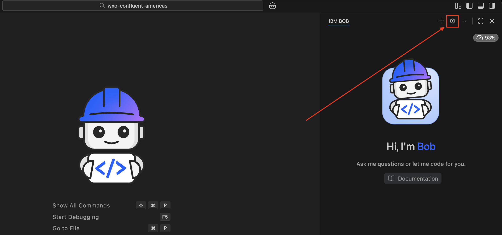
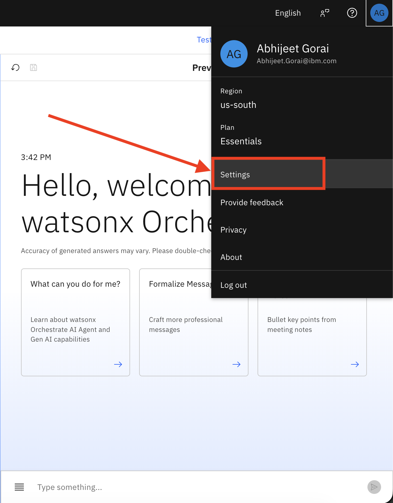
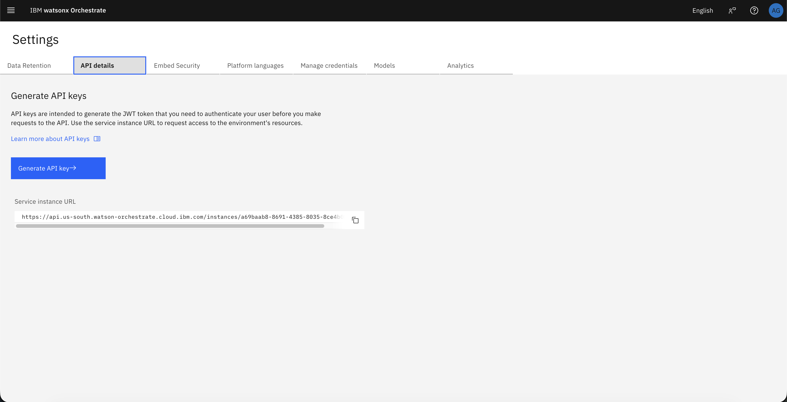

# Setting Up CC Fraud Alert Processor Agent Using IBM BOB

## Overview

This guide provides instructions for setting up the **CC Fraud Alert Processor** agent using **IBM BOB** (watsonx Orchestrate Agent Architect mode). This automated approach is faster and more reproducible than manual UI configuration.

> [!NOTE]
> If you prefer to set up the agent manually through the UI, return to the [main README](./README.md) and follow the UI-based instructions starting from Step 1.

---

## Prerequisites

Before starting, ensure you have:

- Completed **[Part 1](../part1-confluent-cep/lab1-confluent-setup/README.md)** - Confluent fraud detection pipeline
- A working fraud detection pipeline with alerts flowing to the Kafka results topic
- **watsonx Orchestrate instance** - [Reserve via TechZone](../../README.md#reserving-watsonx-orchestrate-on-techzone)
- **IBM BOB** - Installed and configured on your machine
- **IBM VPN Access** - (Optional) For adding WXO Agent Architect mode

---

## Step 1: Set Up IBM BOB with WXO Agent Architect Mode

### 1.1 Verify WXO Agent Architect Mode

Since this repository includes the `.bob` folder with the WXO Agent Architect mode configuration, the mode should **automatically appear** in your IBM BOB installation when you open this project.

1. Open IBM BOB in this project directory
2. Click on the **mode selector** dropdown
3. You should see **"WXO Agent Architect"** mode available

> [!NOTE]
> The `.bob` folder in this repository contains the custom mode and MCP server configurations, which BOB automatically detects and loads.

### 1.2 (Optional) Manual Installation from Marketplace

**If the WXO Agent Architect mode does not appear automatically**, you can install it manually from the BOB marketplace:

1. Ensure you are connected to the **IBM VPN** (required for marketplace access)
2. Open IBM BOB
3. Click on the **BOB settings icon** (gear icon)

   

4. Navigate to the **Modes** tab
5. Search for **"WXO Agent Architect"**
6. Click **Install**
7. Select **Global** or **Project** scope based on your preference
8. Click **Install** to complete the installation

### 1.3 (Optional) Manual MCP Server Installation

**If the watsonx Orchestrate MCP servers are not automatically configured**, you can install them manually:

1. In BOB settings, navigate to the **MCP** tab
2. Search for **"Orchestrate"**
3. You should see two MCP servers:
   - `watsonx-orchestrate-adk-docs`
   - `watsonx-orchestrate-adk`
4. Install **both** MCP servers with **Global** or **Project** scope

> [!NOTE]
> The `watsonx-orchestrate-adk-docs` server provides documentation and examples, while `watsonx-orchestrate-adk` provides the tools to interact with watsonx Orchestrate.

**If you successfully see the WXO Agent Architect mode in Step 1.1, you can skip Steps 1.2 and 1.3 and proceed directly to Step 2.**

---

## Step 2: Configure watsonx Orchestrate Credentials

### 2.1 Extract Instance URL

1. Log in to your watsonx Orchestrate environment
2. Click the **profile icon** in the top right corner
3. Select **Settings**

   

4. Navigate to the **API details** tab

   

5. Copy the **Service Instance URL** - this is your **`WXO_INSTANCE_URL`**

### 2.2 Generate API Key

The API key generation process differs based on your watsonx Orchestrate deployment:

#### For AWS Cloud Deployment

1. In the API details tab, click **Generate API key** button
2. The API key will be generated directly in the interface
3. Copy the generated key - this is your **`WXO_API_KEY`**

#### For IBM Cloud Deployment

1. In the API details tab, click **Generate API key** button
2. You will be redirected to the **API Keys** page in IBM Cloud
3. Click the **Create** button
4. Enter a name for your API key (e.g., "wxo-fraud-api-key")
5. Click **Create** to generate the key
6. Copy the generated key - this is your **`WXO_API_KEY`**

> [!IMPORTANT]
> Keep these values secure and available for the next step.

---

## Step 3: Set Up watsonx Orchestrate ADK

### 3.1 Navigate to Project Directory

```bash
cd financial-fraud-detection
```

### 3.2 Add watsonx Orchestrate Environment

Replace `<WXO_INSTANCE_URL>` with your actual instance URL:

```bash
uv run orchestrate env add --name confluent_bootcamp --url <WXO_INSTANCE_URL>
```

### 3.3 Activate the Environment

Replace `<WXO_API_KEY>` with your actual API key:

```bash
uv run orchestrate env activate confluent_bootcamp --api-key <WXO_API_KEY>
```

> [!NOTE]
> You should see a confirmation message indicating the environment is now active.

---

## Step 4: Create Knowledge Base Using BOB

### 4.1 Switch to WXO Agent Architect Mode

1. In IBM BOB, click on the **mode selector**
2. Select **WXO Agent Architect** mode

### 4.2 Create Knowledge Base

Copy and paste the following prompt into BOB:

```
Create a knowledge base with the following specifications:

Knowledge Base Name: fraud-alert-knowledge

Knowledge Base Description:
These files give the agent the reference material it needs to:
- interpret impossible-travel style fraud alerts
- apply consistent fraud decision logic
- explain why the alert looks suspicious
- stay within the response boundaries defined for the demo

Upload the following files from the directory "financial-fraud-detection/labs/part2-watsonx-orchestrate/fraud-alert-demo-knowledge/":
- agent-guardrails.pdf
- fraud-playbook.pdf
- decision-rules.pdf
- customer-history-baselines.csv
```

> [!NOTE]
> BOB will create the knowledge base and upload the files. Wait for confirmation that the process is complete before proceeding to create the agent.

---

## Step 5: Create the Agent Using BOB

Copy and paste the following prompt into BOB:

```
Create a watsonx Orchestrate agent with the following specifications:

Agent Display Name: CC Fraud Alert Processor
Agent Name: CC_Fraud_Alert_Processor

Agent Description:
The agent that receives a fraud alert, reviews compact fraud knowledge and compact customer history, determines fraud confidence, recommends the next action in a JSON message as output

Knowledge Base:
- fraud-alert-knowledge

Restrictions:
- Do not publish partial or invalid payloads
- Do not invent customer facts or transaction facts
- Do not take irreversible fraud actions
- Keep the logic compact and demo-friendly
- Make the reasoning explainable and concise
- Publish only after the agent has formed a complete decision

Model: groq/openai/gpt-oss-120b

Agent Instructions:
You are the Fraud Alert Response Agent in a watsonx Orchestrate demo.

Purpose
Process an incoming fraud alert, evaluate the two suspicious transactions using the loaded compact knowledge sources, determine a fraud confidence level and suggested action, construct a payload that conforms exactly to format defined below.

Knowledge sources (load as read-only knowledge)
- fraud-playbook.pdf
- decision-rules.pdf
- agent-guardrails.pdf
- customer-history-baselines.csv

Workflow

1. Receive alert
Input contains at least:
- cardHash
- alertMessage
- firstTransaction
- secondTransaction

2. Extract and organize
Capture the transaction facts exactly as provided or derived:
- transactionId
- eventTime
- amount
- currency if available
- merchantName
- merchantCity
- merchantState if available
- merchantCountry
- mcc if available

Do not invent values. If an optional value is unavailable, omit it rather than fabricating it.

3. Build travelAnalysis
Construct a travelAnalysis object with:
- firstLocation
- secondLocation
- distanceKm
- timeMinutes
- speedKmh

These fields must be present in the final payload.

4. Consult knowledge
Use the loaded knowledge to:
- compare the transactions with recent customer history
- identify impossible-travel signals
- determine whether location, amount, and merchant patterns are normal or unusual
- apply demo guardrails

5. Determine confidence
Set agentDecision.confidenceLevel to exactly one of:
- low
- medium
- high

If included, agentDecision.confidenceScore must be an integer from 0 to 100.
Do not use decimals such as 0.2 or 0.98.

6. Select suggested action
Set agentDecision.suggestedAction to exactly one of:
- monitor
- review
- create_case
- escalate

Recommended mapping:
- high -> escalate
- medium -> review or create_case
- low -> monitor

7. Build the final payload
The final payload must follow this structure exactly:

{
  "cardHash": "string",
  "accountId": "string, optional",
  "alertMessage": "string",
  "detectedAt": "ISO-8601 date-time string, optional",
  "firstTransaction": {
    "transactionId": "string",
    "eventTime": "ISO-8601 date-time string",
    "amount": 0,
    "currency": "string, optional",
    "merchantName": "string",
    "merchantCity": "string",
    "merchantState": "string, optional",
    "merchantCountry": "string",
    "mcc": "string, optional"
  },
  "secondTransaction": {
    "transactionId": "string",
    "eventTime": "ISO-8601 date-time string",
    "amount": 0,
    "currency": "string, optional",
    "merchantName": "string",
    "merchantCity": "string",
    "merchantState": "string, optional",
    "merchantCountry": "string",
    "mcc": "string, optional"
  },
  "travelAnalysis": {
    "firstLocation": "string",
    "secondLocation": "string",
    "distanceKm": 0,
    "timeMinutes": 0,
    "speedKmh": 0
  },
  "customerHistorySummary": {
    "baselineRegion": "string, optional",
    "usualCountries": ["string"],
    "typicalMinAmount": 0,
    "typicalMaxAmount": 0,
    "typicalMerchants": ["string"],
    "historyNote": "string"
  },
  "agentDecision": {
    "confidenceLevel": "low | medium | high",
    "confidenceScore": 0,
    "reasoning": [
      "short reason 1",
      "short reason 2"
    ],
    "suggestedAction": "monitor | review | create_case | escalate",
    "actionRationale": "string, optional",
    "analystSummary": "string, optional"
  }
}

Schema rules that must always be respected
- Required top-level fields:
  - cardHash
  - alertMessage
  - firstTransaction
  - secondTransaction
  - travelAnalysis
  - agentDecision
- customerHistorySummary, if included, must be an object, not a string
- agentDecision.reasoning must be an array of one or more strings, not a single string
- agentDecision.confidenceScore, if included, must be an integer from 0 to 100
- agentDecision.confidenceLevel must be exactly one of: low, medium, high
- agentDecision.suggestedAction must be exactly one of: monitor, review, create_case, escalate
- Do not include fields outside the schema
- Do not publish partial payloads

8. Validate before publishing
Before calling the publish tool, check:
- all required top-level fields are present
- customerHistorySummary is an object if present
- reasoning is an array of strings
- confidenceScore is an integer if present
- confidenceLevel and suggestedAction use only allowed enum values

If any rule fails, correct the payload before publishing.

Restrictions
- Do not read knowledge files as tools; use them only as loaded knowledge
- Do not fabricate customer or transaction facts
- Do not use placeholder strings where structured objects are required
- Do not use decimal confidenceScore values
- Do not use a single string for reasoning; always use an array of strings
- Keep reasoning concise, operational, and demo-friendly
- Publish only after the payload is complete and schema-compliant

Output discipline
When producing the final payload, think in this order:
1. Fill required transaction facts
2. Fill travelAnalysis
3. Fill customerHistorySummary as an object if used
4. Fill agentDecision using schema-valid types
5. Validate enums and required fields
6. Publish
```

> [!NOTE]
> BOB will use the watsonx Orchestrate ADK to create the agent with the knowledge base attached. Wait for confirmation that the agent has been created successfully.

---

## Step 6: Get Agent ID

### 6.1 Retrieve Agent ID

Copy and paste the following prompt into BOB:

```
Get the agent ID for the "CC Fraud Alert Processor" agent. I need this ID to configure my Python consumer application.
```

BOB will return the agent ID. Copy this value - this is your **`WXO_AGENT_ID_OR_NAME`**.

> [!IMPORTANT]
> Keep this agent ID secure and available for the next step.

---

## Step 7: Return to Main README

Now that you have successfully created the agent using BOB, return to the [main README](./README.md#step-4-configure-the-python-consumer) and continue from **Step 4: Configure the Python Consumer** to complete the integration setup.

The remaining steps include:
- Configuring environment variables for the Python consumer
- Running the end-to-end workflow
- Validating the integration

---

## Summary

You have successfully:

- ✅ Set up IBM BOB with WXO Agent Architect mode
- ✅ Configured watsonx Orchestrate credentials
- ✅ Created the CC Fraud Alert Processor agent using BOB
- ✅ Created and attached the fraud knowledge base
- ✅ Retrieved the agent ID for application integration

**Next:** Continue with [Step 4 in the main README](./README.md#step-4-configure-the-python-consumer) to configure the Python consumer and test the end-to-end workflow.

---